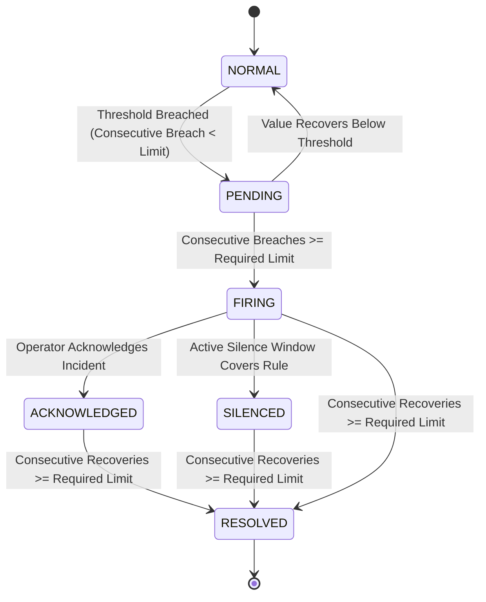

# M14 — Alerting Engine, Inhibition & Incident State Machine

This document details the alert evaluation pipeline, deduplication fingerprinting, state machine transitions, notification dispatch, SSRF protection, and incident lifecycle management implemented in Milestone 14.

---

## 1. Alert Evaluation Pipeline

The alerting subsystem (`app.modules.alerting`) continuously evaluates active metrics against configured rules:

### Deterministic Fingerprinting:
To eliminate alert duplication and notification storms, each alert instance computes an SHA-256 fingerprint from:
- `alert_rule_id`
- `customer_site_id` (or `global`)
- Label dimensions (e.g. `slot_name=SLOT_A`, `endpoint=/api/v1/runtime/chat`)

Subsequent evaluation cycles locate the active `AlertInstance` via its fingerprint rather than creating duplicate entries.

---

## 2. Alert Inhibition Rules

When a primary infrastructure failure occurs (e.g., `SiteAgentHeartbeatMissing` or `SlotUnhealthyOrUnready`), downstream symptom alerts (e.g., `HighInferenceLatencyP95`, `LowRequestRate`) are inhibited to prevent alert fatigue:

- **Root Rule**: `SlotUnhealthyOrUnready` (Severity: `CRITICAL`)
- **Inhibited Targets**: `HighInferenceLatencyP95`, `HighRequestErrorRate` on the matching slot.
- **Inhibition State**: The instance enters state `INHIBITED_BY_OUTAGE`. Notifications for inhibited instances are suppressed.

---

## 3. Notification Routing & SSRF Protection

Notifications are dispatched via `NotificationRouter`:
1. **Local Store (Default)**: Writes to `notification_deliveries` database table with zero network egress.
2. **Webhook (Optional)**: Dispatches HTTP POST payloads to configured operator endpoints (e.g., Slack/Discord incoming webhooks or incident management bridges).

### Webhook SSRF Prevention Specification:
All webhook URLs are strictly validated prior to outbound socket connection:
- Disallowed hostnames: `localhost`, `*.local`, `*.internal`, `127.*`, `10.*`, `172.16.*-172.31.*`, `192.168.*`, `169.254.*` (Cloud instance metadata services like AWS/GCP `169.254.169.254`).
- Scheme must be `http://` or `https://`.
- DNS resolution checks target IP to ensure internal IP addresses cannot be accessed via DNS rebinding.

---

## 4. Incident Management Lifecycle

Incidents track operational degradations through resolution:

```mermaid
stateDiagram-v2
    [*] --> OPEN: Created from Alert or Operator Action
    OPEN --> INVESTIGATING: Operator Assigned / Triaging
    INVESTIGATING --> MITIGATING: Remediation in Progress (e.g., Rollback)
    MITIGATING --> MONITORING: Remediation Applied; Verifying Stability
    MONITORING --> RESOLVED: Performance Restored & Verified
    RESOLVED --> CLOSED: Post-Mortem Documented & Closed
    CLOSED --> [*]
```

### Sequential Incident Numbering:
Incidents receive human-readable identifiers (`INC-0001`, `INC-0002`, etc.) uniquely scoped per workspace.

### Audit Timeline:
Every status transition, operator note, or linked rollback execution is immutably recorded in `incident_events` with timestamps and actor identities.
