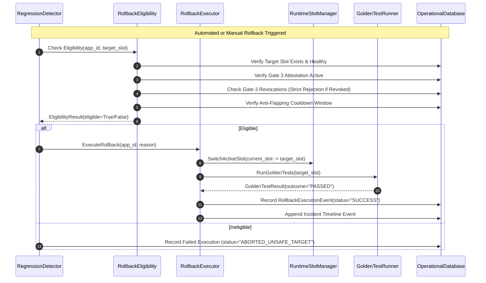

# M14 — Automated Rollback Policy Engine & Blue/Green Safety Transitions

This document specifies the rollback eligibility engine, regression detector, anti-flapping guardrails, cryptographic release verification, and atomic Blue/Green slot transitions implemented in Milestone 14 (`app.modules.rollback`).

---

## 1. Safety Semantics & Blue/Green Slot Transitions

In Mizan, rollback is strictly an **atomic Blue/Green slot transition** reusing Milestone 13's slot orchestrator (`RuntimeSlotManager`), never an in-place artifact modification or file deletion:

---

## 2. Policy Modes

The `RollbackPolicy` governs behavior per application:
1. **`DISABLED`**: Automated and manual rollback triggers are rejected.
2. **`MANUAL_ONLY` (Default)**: Rollback can only be initiated by an authorized operator through the UI or API. Automated regression detection logs warnings and opens incidents, but does not switch slots.
3. **`AUTOMATIC`**: Rollback is executed autonomously when regression criteria are sustained across the configured evaluation window. Requires explicit operator opt-in.

---

## 3. Strict Pre-Transition Safety Checklist

Before any slot transition can occur, `RollbackEligibilityValidator` verifies all seven safety conditions:
1. **Target Slot Exists**: An alternate slot (e.g. `SLOT_B` if `SLOT_A` is active) exists for the application.
2. **Target Slot Has Model & App Versions**: The target slot contains an installed, valid release.
3. **Gate 3 Human Approval**: The target model version has an authorized, cryptographically signed `Gate3Approval` attestation.
4. **Zero Gate 3 Revocations**: There are NO active `Gate3Revocation` records for the target model version. Any revocation immediately aborts the rollback with `ABORTED_UNSAFE_TARGET`.
5. **Release Manifest Checksum Match**: The target release manifest matches its recorded cryptographic digest.
6. **Anti-Flapping Cooldown**: No rollback operation has been executed within the last `cooldown_seconds` (default: 600s).
7. **Max Daily Attempts**: The count of automatic rollbacks in the last 24 hours has not exceeded `max_automatic_attempts_per_release` (default: 3).

---

## 4. Post-Transition Verification & Audit Trail

Immediately upon switching traffic to the target slot:
1. **Golden Test Execution**: `GoldenTestRunner` runs mandatory test cases against the newly activated slot.
2. **Event Recording**: A `RollbackExecutionEvent` is written with `from_slot_name`, `to_slot_name`, `trigger_type`, `trigger_reason`, `verification_passed`, and `executed_by`.
3. **Incident Timeline Integration**: If an active incident is open for the application, the rollback event is automatically linked to the incident's timeline.
