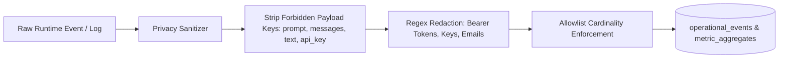

# M14 — Telemetry, Monitoring, Metrics & Privacy Architecture

This document specifies the real-time operational telemetry, OpenTelemetry-compatible metrics exposition, label cardinality guardrails, storage retention, and privacy filtering implemented in Milestone 14 of the Mizan Platform.

---

## 1. Architectural Principles & Free-Tier Invariants

1. **Zero-Spend Observability**: Mizan strictly implements self-hosted, open-source telemetry components ($0.00 additional spend). Telemetry does not rely on Datadog, Dynatrace, New Relic, AWS CloudWatch, or Google Cloud Operations SaaS.
2. **Prometheus Standard Exposition**: The customer runtime and central API expose standard Prometheus 0.0.4 text format metrics over HTTP at `/api/v1/ops/metrics/prometheus` and `/metrics`.
3. **Cardinality Budgeting**: All metrics adhere to bounded label sets (`service`, `endpoint`, `status_class`, `runtime_engine`, `slot_name`, `site_id`, `severity`). High-cardinality values such as user IDs, document IDs, query texts, or hashes are strictly forbidden.
4. **Absolute Privacy Preservation**: Prompts, completions, sensitive entity text, document chunks, and authorization tokens are strictly filtered and purged before metrics or operational event logs are generated.
5. **Missing Telemetry != Health**: Silence from a customer site or runtime engine is never interpreted as 100% healthy. A missing heartbeat or missing telemetry stream transitions the SLO and health indicators to `UNKNOWN` or `DEGRADED`.

---

## 2. Standard Metric Catalog

Mizan exposes structured operational metrics across four fundamental operational vectors:

| Metric Name | Type | Description | Allowlisted Labels |
|---|---|---|---|
| `runtime_requests_total` | Counter | Total HTTP inference requests handled | `service`, `endpoint`, `status_class`, `runtime_engine`, `slot_name`, `site_id` |
| `runtime_request_duration_ms` | Histogram | Request latency distribution in milliseconds | `service`, `endpoint`, `runtime_engine`, `slot_name`, `site_id` |
| `runtime_active_slot_info` | Gauge | Active slot indicator (1.0 for active slot) | `application_id`, `slot_name`, `model_version_id`, `site_id` |
| `runtime_readiness_state` | Gauge | Slot readiness (1 = READY, 0 = UNREADY/DEGRADED) | `application_id`, `slot_name`, `site_id` |
| `runtime_inference_tokens_total` | Counter | Tokens processed during inference | `type` (`prompt` / `completion`), `runtime_engine`, `site_id` |
| `runtime_cpu_usage_percent` | Gauge | Real-time system CPU utilization (0-100%) | `site_id`, `component` |
| `runtime_memory_allocated_mb` | Gauge | Real-time system memory usage in Megabytes | `site_id`, `component` |
| `runtime_vram_allocated_mb` | Gauge | Hardware accelerator VRAM allocation | `site_id`, `device_id` |
| `runtime_golden_test_status` | Gauge | Result of slot verification (1 = PASS, 0 = FAIL) | `slot_name`, `application_id`, `suite_id` |
| `site_agent_heartbeat_timestamp_seconds` | Gauge | Epoch timestamp of last received site heartbeat | `site_id`, `site_key` |
| `mizan_slo_current_percentage` | Gauge | Calculated Service Level Indicator percentage | `slo_id`, `workspace_id`, `site_id` |
| `mizan_slo_error_budget_remaining_ratio` | Gauge | Remaining error budget ratio (0.0 - 1.0) | `slo_id`, `workspace_id` |

---

## 3. Privacy Filtering & Sanitization Pipeline

Mizan implements a zero-trust telemetry sanitizer (`app.modules.observability.telemetry_privacy`):

### Forbidden Payload Attributes:
Any dictionary keys matching the following patterns are stripped or replaced with `[REDACTED_PRIVACY]`:
- `prompt`, `messages`, `completion`, `output_text`, `input_text`, `raw_query`, `document_text`, `context_chunk`, `chunk_content`.
- `api_key`, `secret`, `token`, `password`, `authorization`, `private_key`.

### Automatic Pattern Redaction:
Even within unrestricted metadata fields, values are filtered against regex rules:
- **Bearer Tokens**: `Bearer [A-Za-z0-9-_=.]+` -> `Bearer [REDACTED_TOKEN]`
- **Ed25519 / RSA Keys**: `-----BEGIN .* PRIVATE KEY-----` -> `[REDACTED_PRIVATE_KEY]`
- **Email Addresses**: `user@domain.com` -> `[REDACTED_EMAIL]`

---

## 4. Operational Event Journal

The `operational_events` table preserves an append-only, privacy-sanitized chronological audit trail of all runtime changes:
- `DEPLOYMENT_ACTIVATION`: Slot switch events and previous slot states.
- `SLOT_READINESS_CHANGED`: Health and golden test outcome transitions.
- `ALERT_FIRED` / `ALERT_RESOLVED`: Incident triggers and recovery timestamps.
- `ROLLBACK_TRIGGERED` / `ROLLBACK_COMPLETED`: Blue/Green slot rollback executions.

Events are retained for 30 days by default (configurable per tenant) and partitioned by `workspace_id` and `customer_site_id`.
