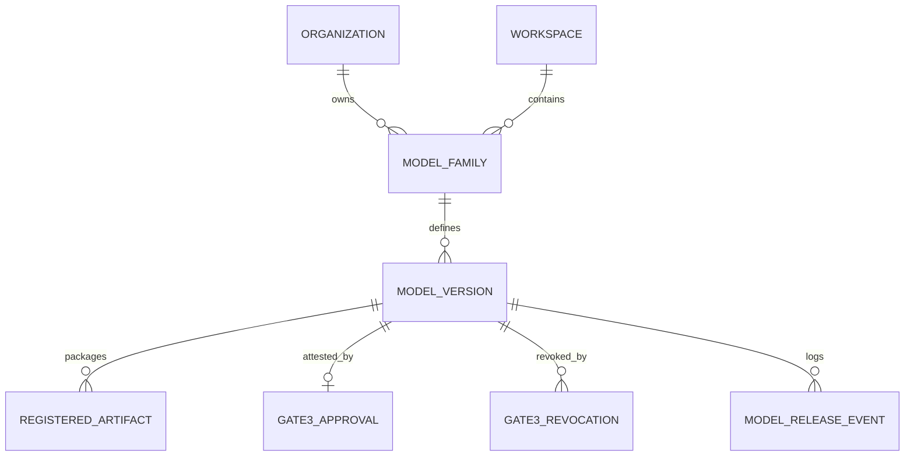

# Milestone 11 Architecture Specification
## Artifact Registry, Model Release Management, Cryptographic Integrity & Gate 3 Human Approval

---

## 1. Overview & Business Context

**Mizan** is an AI experimentation, evaluation, optimization, and deployment platform for businesses. Following model adaptation, fine-tuning, and quantization in Milestone 10, **Milestone 11** establishes the governed, immutable **Artifact Registry** and **Gate 3 Human Release Approval** workflow.

Milestone 11 bridges the experimental model-building lifecycle (M10) and downstream catalog/deployment mechanisms (M12 Model Zoo and M13 Customer Runtime) by enforcing:
1. **Immutable Model Family and Version Packaging:** Once finalized, model releases cannot be modified in-place or silently swapped.
2. **Deterministic Canonical Release Manifests:** SHA-256 cryptographic digest calculated across all registered binaries, LoRA adapters, quantizations, tokenizers, and configuration metadata.
3. **5-Pillar Provenance Verification:** Programmatic pre-release validation spanning Base Model Licensing, Dataset Data Rights & Gate 1, Build Manifest Integrity, Evaluation Quality & Safety Evidence (with strict anti-regression thresholds), and Target Hardware Feasibility.
4. **Gate 3 Human Approval & Multi-Stakeholder Governance:** Authorized sign-off with strict **Separation of Duties** (preventing model authors from approving their own releases without explicit policy overrides) and Ed25519 digital signature attestation.
5. **Revocation & Append-Only Audit Trail:** Controlled, auditable post-release deprecation and revocation preserving historical attestation trails.

---

## 2. Core Entities & Data Architecture



### 2.1 Model Families (`ModelFamily`)
- Acts as a high-level namespace for related model iterations (e.g., `Customer Support Assistant`, `Contract Summarizer`).
- Enforces workspace multi-tenant isolation and unique slug routing within a workspace.
- Supports lifecycle states: `ACTIVE`, `ARCHIVED`.

### 2.2 Model Versions (`ModelVersion`)
- Represents an immutable candidate or approved release package (e.g., `v1.0.0`, `v1.1.0-lora`).
- Fields:
  - `status`: `DRAFT` -> `PENDING_REVIEW` -> `APPROVED` | `REJECTED` | `REVOKED` | `EXPIRED` | `ARCHIVED`.
  - `is_immutable`: Locked immediately upon manifest finalization or approval.
  - `release_manifest_digest`: SHA-256 hex digest of the canonical release manifest.
  - `provenance_summary`: JSON snapshot of the 5-pillar verification checks, warnings, and blockers.
  - Evaluation baselines: `base_evaluation_score`, `final_evaluation_score`, `quality_delta`.
  - Hardware execution limits: `min_ram_mb`, `min_vram_mb`, `target_hardware_key`.

### 2.3 Registered Artifacts (`RegisteredArtifact`)
- Links M10 staged artifacts (`StagedModelArtifact`) into the immutable release.
- Stores format, quantization type (`GGUF_Q4_K_M`, `AWQ_4BIT`, etc.), verified file size, SHA-256 hash, and storage URI.
- Designates whether the artifact represents primary model weights or supplementary assets (tokenizers, configs).

### 2.4 Gate 3 Approval Attestation (`Gate3Approval`)
- Records the formal release decision by an authorized reviewer.
- Captures reviewer ID, role snapshot (`LEAD_REVIEWER`, `COMPLIANCE_OFFICER`, etc.), review timestamp, optional expiry date, and decision reason.
- Contains the Ed25519 digital signature generated specifically with `signature_purpose = "GATE3_RELEASE_APPROVAL"`.

### 2.5 Gate 3 Revocation (`Gate3Revocation`)
- Provides post-approval revocation capabilities when compliance, security, or data errors are identified.
- Captures revoker identity, role snapshot, formal reason (minimum 5 characters), and UTC revocation timestamp.

### 2.6 Model Release Events (`ModelReleaseEvent`)
- Append-only tamper-evident audit history tracking every state transition:
  - `VERSION_CREATED`
  - `ARTIFACT_REGISTERED`
  - `MANIFEST_FINALIZED`
  - `GATE3_APPROVED` / `GATE3_REJECTED`
  - `GATE3_REVOKED`

---

## 3. The 5-Pillar Provenance Verification Engine

Before any release candidate can be finalized and submitted to Gate 3, `ProvenanceVerificationService` executes a rigorous 5-pillar audit:

| Pillar | Focus Area | Verification Rule |
| :--- | :--- | :--- |
| **1. Base Model & License** | Model Licensing & Gating | Validates source repository, access status (`OPEN` or `AUTHENTICATED`), and commercial compatibility. Flags restrictive or non-commercial licenses. |
| **2. Data Rights & Gate 1** | Training Data Provenance | Verifies dataset version digest match, ensures dataset status is `APPROVED`, and confirms presence of a valid Gate 1 attestation. |
| **3. Build Manifest & Recipe** | Build Reproducibility | Inspects M10 build run status (`COMPLETED`), matches recipe key/version, verifies training configuration digest, and ensures at least one primary weight artifact is present. |
| **4. Evaluation & Quality** | Quality Delta & Anti-Regression | Compares `final_evaluation_score` against `base_evaluation_score`. Rejects packages exhibiting performance regression exceeding threshold ($\Delta < -0.05$). |
| **5. Hardware Feasibility** | Deployment Safety | Confirms `min_ram_mb` and `min_vram_mb` are non-zero, validates compatibility with target hardware profiles, and warns on memory configurations exceeding 48 GB host RAM. |

---

## 4. Cryptographic Integrity & Canonical Release Manifests

### 4.1 Canonical Manifest Structure
The release manifest is constructed deterministically:
1. All dictionary keys are sorted alphabetically recursively.
2. Identifiers, versions, provenance summaries, and artifact lists are formatted into a canonical dictionary.
3. Artifacts are sorted deterministically by SHA-256 checksum.
4. Serialized with `json.dumps(manifest_dict, sort_keys=True, separators=(',', ':'))`.
5. The canonical manifest digest is calculated as `hashlib.sha256(canonical_bytes).hexdigest()`.

### 4.2 Ed25519 Attestation & Signature Purpose Separation
To eliminate cross-gate replay attacks (e.g. attempting to pass a Gate 1 dataset attestation or Gate 2 spend signature as a Gate 3 release approval):
- The canonical signature payload explicitly embeds:
  ```json
  {
    "signature_purpose": "GATE3_RELEASE_APPROVAL",
    "model_version_id": "...",
    "release_manifest_digest": "...",
    "decision": "APPROVED",
    "reviewer_user_id": "...",
    "reviewed_at": "..."
  }
  ```
- Verification strictly fails with `SignaturePurposeMismatchError` if `signature_purpose != "GATE3_RELEASE_APPROVAL"`.

---

## 5. Security Invariants & Governance

1. **Separation of Duties (SoD):** Under standard governance policies, the model author (`created_by`) cannot approve Gate 3 release for their own model version. Violations raise `SeparationOfDutiesViolationError` unless an explicit administrative bypass is recorded.
2. **Release Immutability:** Any attempt to register additional artifacts, alter metadata, or modify manifests on an `APPROVED` or `PENDING_REVIEW` version raises `ImmutableReleaseError` (HTTP 409 Conflict).
3. **Tenant Isolation:** All operations are scoped strictly within the active workspace and parent organization. Cross-workspace artifact promotion is forbidden and returns HTTP 404 (preventing workspace enumeration).
4. **$0.00 Additional Spend:** All cryptographic operations (Ed25519 signing, SHA-256 verification) and provenance checks run entirely locally using standard Python libraries and local keys.
