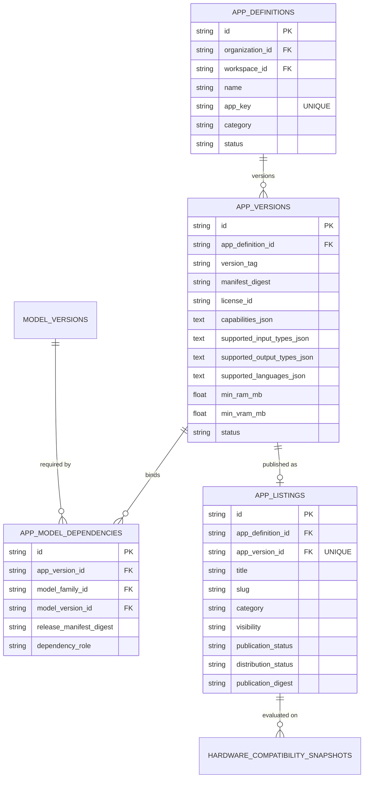

# Milestone 12 — App Zoo Architecture

## 1. Overview and Purpose

The **App Zoo** is the enterprise catalog for declarative AI applications, intelligent agents, and RAG pipelines in Mizan.

While the Model Zoo distributes raw approved model weights and adapters, modern enterprises deploy integrated AI systems that combine:
- Specific fine-tuned model versions.
- Prompt templates and system instructions.
- Declared tools and retrieval augmentation parameters.
- Validated input and output schemas.
- Resource allocation and memory constraints.

The App Zoo provides a structured, versioned, and governed catalog of these application packages, ensuring complete traceability back to approved models and data protection attestations.

---

## 2. Core Architectural Principles

- **Strict Model Binding**: Every `AppVersion` must explicitly bind to one or more approved M11 model releases (`AppModelDependency`). An application cannot declare dependencies on unapproved or draft models.
- **Declarative Immutability**: Each `AppVersion` contains a canonical JSON application manifest. Its SHA-256 hash (`manifest_digest`) uniquely identifies the configuration. Once created, an `AppVersion` cannot be altered.
- **Automatic Revocation Propagation**: If an underlying M11 model release is revoked, the system cascades this revocation across all dependent `AppVersion` records (setting status to `BLOCKED`) and suspends associated `AppListing` entries in the catalog.
- **Pre-M13 Boundary**: The App Zoo catalogs and shares declarative specifications. It does **not** launch Docker containers, manage Kubernetes pods, or host customer-facing HTTP microservices (reserved for Milestone 13).

---

## 3. Data Model & Schema Relationships

---

## 4. Declared Capabilities and Compatibility

Each application version declares its operational profile:
- **Capabilities**: Standardized vocabulary of tasks (e.g., `DOCUMENT_RETRIEVAL`, `SUMMARIZATION`, `CODE_GENERATION`, `SENTIMENT_ANALYSIS`, `TOOL_CALLING`).
- **I/O Formats**: MIME types or structured formats accepted (e.g., `PDF`, `TXT`, `DOCX`, `JSON`) and returned (e.g., `JSON`, `MARKDOWN`, `TEXT`).
- **Language Support**: ISO language codes supported by the prompt and model configuration (e.g., `en`, `ar`).
- **Hardware Footprint**: Aggregates component memory requirements with the bound model's footprint to compute minimum RAM and VRAM requirements.

---

## 5. Integration with Model Zoo

The App Zoo is deeply integrated with the Model Zoo:
1. In the frontend App Detail view, users can navigate directly to the linked Model Zoo release for each dependency.
2. The installation guide generates complete, deterministic deployment specifications linking the app manifest to the exact release manifest digest of each model.
3. Catalog searches can filter applications by the specific models or architectures they utilize.
