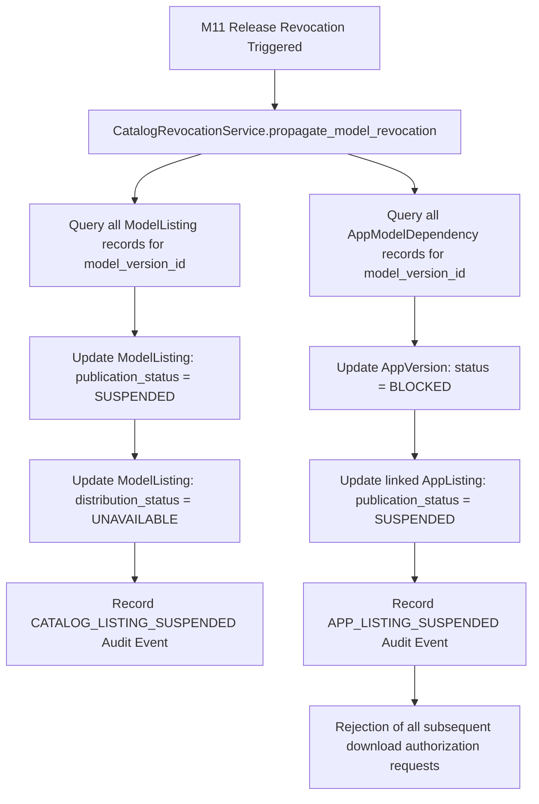

# Milestone 12 — Catalog Publication Governance & Sanitization

## 1. Overview and Principles

Publishing AI models and applications across enterprise boundaries or into the public domain carries severe legal, privacy, and intellectual property risks.

Mizan enforces a strict governance and sanitization architecture for all catalog publications:

1. **Separation of Duties**: Listing authors (`CATALOG_MANAGE`) cannot approve their own listings for publication; a designated catalog reviewer holding `CATALOG_PUBLISH` must review and attest to the listing.
2. **License & Commercial Rights Enforcement**: Models with non-commercial or restrictive licenses cannot be published to `PUBLIC` catalogs as downloadable weights.
3. **Disclosure Sanitization**: Every public catalog listing strips all internal database identifiers, workspace slugs, storage paths, and user identities.
4. **Deterministic Publication Fingerprinting**: All published listings are fingerprinted with a canonical SHA-256 `publication_digest`.
5. **Immediate Revocation Propagation**: Any revocation of an underlying M11 release instantly cascades to suspend linked catalog listings and block downloads.

---

## 2. Role-Based Access Control (RBAC) Matrix

| Workspace Role | CATALOG_READ | CATALOG_MANAGE | CATALOG_PUBLISH | CATALOG_DOWNLOAD |
| :--- | :---: | :---: | :---: | :---: |
| **WORKSPACE_OWNER** | Yes | Yes | Yes | Yes |
| **WORKSPACE_ADMIN** | Yes | Yes | Yes | Yes |
| **WORKSPACE_MEMBER** | Yes | Yes | No | Yes |
| **WORKSPACE_VIEWER** | Yes | No | No | No |

---

## 3. Public Rights & Licensing Gate

When a listing is submitted for `PUBLIC` visibility with `distribution_status == DOWNLOADABLE`:

1. The service queries the M11 `ModelVersion` provenance record (`provenance_summary_json`).
2. It inspects the `BASE_MODEL_LICENSE` and `RECIPE_LICENSE` check results.
3. If `commercial_use == False` or `redistribution_allowed == False`, publication is rejected with `PublicPublicationNotAllowedError`:
   > *"Public publication is not permitted: base model license restricts commercial use or redistribution."*
4. The listing must either remain restricted to `WORKSPACE`/`ORGANIZATION` scope or have its distribution status set to `METADATA_ONLY`.

---

## 4. Public Metadata Sanitization Engine

Before any catalog listing is rendered to external consumers or written to the `public_metadata_snapshot_json` field, the `PublicMetadataSanitizer` runs:

### Fields Preserved (Public Surface)
- Listing title, slug, description, detailed description, category, and tags.
- Model family name, slug, and task type.
- Model version tag, source model key (public HuggingFace ID), and recipe key.
- Evaluation metrics: base score, final score, quality delta.
- Hardware specifications: min RAM, min VRAM, target hardware key.
- Hardware compatibility snapshots (`TESTED`, `ESTIMATED`, `INCOMPATIBLE`, `UNKNOWN`).
- Release manifest digest (immutable 64-character SHA-256).
- Public artifact metadata: artifact type, file format, quantization type, file size in bytes, and SHA-256 checksum.

### Fields Strictly Redacted (Zero Disclosure)
- Internal primary keys: `organization_id`, `workspace_id`, `model_family_id`, `model_version_id`, `app_definition_id`, `created_by`, `published_by`.
- Storage references: S3 bucket names, Azure Blob container paths, or local file system storage paths.
- Training data details: Gate 1 approval IDs, raw dataset names, document names, and internal masking run statistics.
- Reviewer identities: Reviewer user IDs and email addresses.

### Canonical Digest Generation
```python
canonical_bytes = json.dumps(sanitized_dict, sort_keys=True, separators=(",", ":")).encode("utf-8")
publication_digest = hashlib.sha256(canonical_bytes).hexdigest()
```

---

## 5. Revocation Cascade Architecture

When an administrator revokes an M11 model release (`Gate3Decision.REVOKED`):



Any subsequent call to `ArtifactDownloadService.authorize_artifact_download` re-checks the live database state and immediately throws `RevokedReleaseError`, preventing any unauthorized egress of compromised models.
