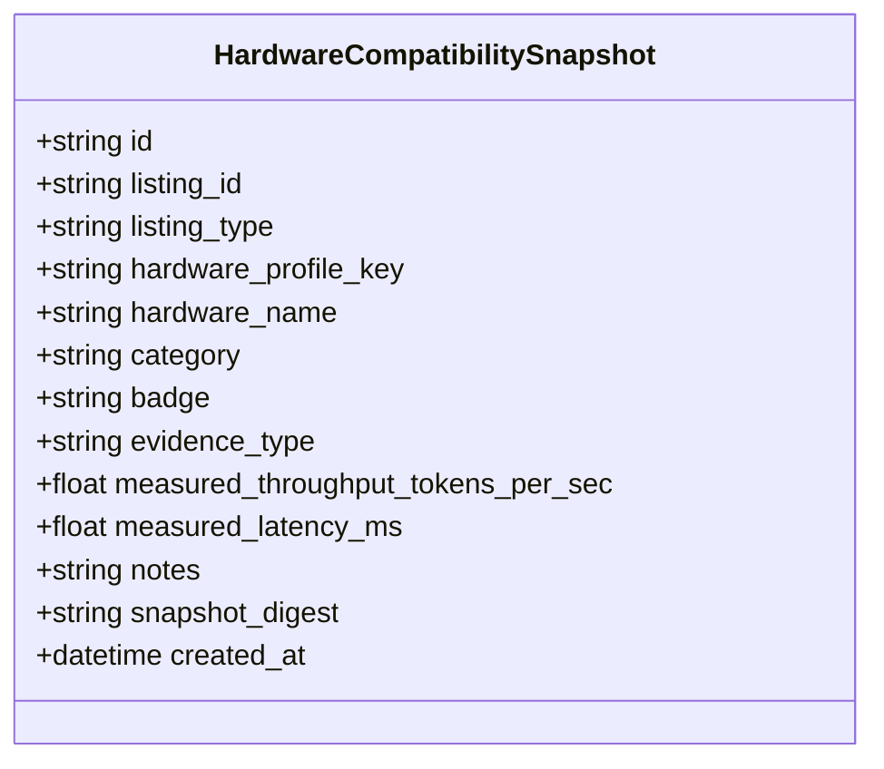

# Milestone 12 — Hardware Compatibility Badges Architecture

## 1. Overview and Core Philosophy

In commercial AI adoption, one of the most frequent points of failure is misleading hardware guidance. Software vendors often declare that a model "runs on consumer hardware" based purely on theoretical parameter counts or unverified simulations, leading to out-of-memory (OOM) crashes, extreme thrashing, or failed customer deployments.

Mizan takes a zero-tolerance stance on misleading hardware claims. **Hardware badges in the Model and App Zoo are strictly evidence-based and audit-backed.**

---

## 2. The Four Compatibility Badge States

| Badge | Criteria | Strict Evidence Rule |
| :--- | :--- | :--- |
| **`TESTED`** | Hardware profile has completed real physical benchmarks measuring latency, throughput, and memory consumption. | **Physical measurement only** (`EvidenceType.MEASURED`). Simulated runs, CPU smoke tests, or vendor datasheets CANNOT produce a `TESTED` badge. |
| **`ESTIMATED`** | Analytical memory and compute estimation based on Milestone 8 resource estimation formulas. | Validated M8 model estimation (`EvidenceType.CALCULATED`), with available memory exceeding requirement. |
| **`INCOMPATIBLE`** | Available RAM or VRAM on the hardware profile is less than the calculated minimum required memory. | Proven constraint violation: attempting execution would result in an immediate OOM error. |
| **`UNKNOWN`** | No hardware profile match, missing benchmark records, or insufficient profiling data. | Default safe state when empirical or analytical evidence is absent. |

---

## 3. Evaluation Rules & Logic Matrix

The `HardwareBadgeService` computes badge status using the following deterministic logic:

```python
if available_ram_mb < min_ram_mb:
    badge = HardwareCompatibilityBadge.INCOMPATIBLE
    notes = f"Insufficient system RAM: requires {min_ram_mb} MB, available {available_ram_mb} MB"
elif is_gpu_required and (available_vram_mb < min_vram_mb):
    badge = HardwareCompatibilityBadge.INCOMPATIBLE
    notes = f"Insufficient VRAM: requires {min_vram_mb} MB, available {available_vram_mb} MB"
elif measured_benchmark is not None and measured_benchmark.evidence_type == EvidenceType.MEASURED:
    badge = HardwareCompatibilityBadge.TESTED
    notes = f"Empirical benchmark confirmed: {measured_benchmark.operations_per_second:.1f} ops/sec"
elif profile.evidence_type == EvidenceType.MEASURED:
    badge = HardwareCompatibilityBadge.TESTED
    notes = "Physical hardware benchmark confirmed on measured workstation"
elif profile.category in (HardwareProfileCategory.LOCAL_WORKSTATION, HardwareProfileCategory.CLOUD_GPU):
    badge = HardwareCompatibilityBadge.ESTIMATED
    notes = "Analytical resource estimation meets minimum hardware thresholds"
else:
    badge = HardwareCompatibilityBadge.UNKNOWN
    notes = "Insufficient evidence to guarantee compatibility"
```

---

## 4. Hardware Compatibility Snapshots

When a model or application listing is reviewed and published, the system captures an immutable snapshot of all evaluated hardware profiles in the `hardware_compatibility_snapshots` table:



### Snapshot Digest
Each snapshot is fingerprinted with a SHA-256 digest of its canonical JSON representation:
`hashlib.sha256(canonical_snapshot_json.encode('utf-8')).hexdigest()`. This ensures that historical hardware claims remain immutable even if the global hardware knowledge base is updated later.

---

## 5. Multi-Component App Aggregation

For applications cataloged in the App Zoo:
1. The service evaluates the base application container memory overhead.
2. It queries all bound M11 model releases declared in `AppModelDependency`.
3. It aggregates the memory footprints:
   $$\text{Total RAM Required} = \text{App Base RAM} + \sum \text{Model Min RAM}$$
4. Hardware badges are evaluated against the cumulative requirement, ensuring that multi-model agent pipelines or RAG workflows are never mislabeled as compatible on under-provisioned machines.
