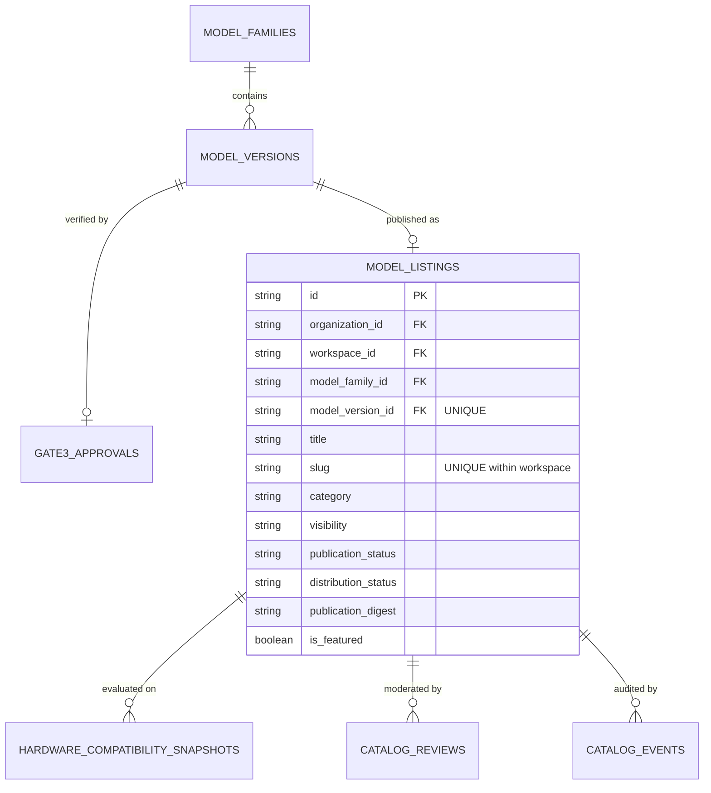

# Milestone 12 — Model Zoo Architecture

## 1. Overview and Purpose

The **Model Zoo** is the enterprise discovery and distribution catalog for AI model releases in Mizan. It serves as the bridge between internal engineering (Milestones 10 and 11) and organizational or ecosystem consumption (Milestones 12 and 13).

The Model Zoo does **not** train models, execute unverified code, or host live inference serving. Instead, it provides a governed, cryptographically verifiable repository of approved model releases where stakeholders can:

1. Discover model releases by task type, domain category, hardware requirements, and quality benchmarks.
2. Review technical specifications, fine-tuning recipes, and base model architectures.
3. Inspect honest hardware compatibility snapshots derived from empirical benchmarks (M8) or analytical estimations.
4. Obtain authorized, tenant-isolated access to verified artifact weights (Safetensors, GGUF quants).
5. Access version-pinned, deterministic installation specifications for downstream integration.

---

## 2. Core Architectural Principles

- **Release Precondition**: Only model releases with an approved **Gate 3 Human Attestation** (`ModelVersionStatus.APPROVED`) can be listed in the Model Zoo. Draft, pending, or rejected releases are strictly rejected at creation.
- **Single Listing Invariant**: Each `ModelVersion` may have at most one catalog listing (`uq_model_listing_version`), ensuring an immutable 1:1 mapping between cryptographic release digest and catalog metadata.
- **Tenant Isolation and Visibility Scopes**:
  - `PRIVATE`: Visible strictly to authorized workspace members.
  - `WORKSPACE`: Discoverable within the originating workspace.
  - `ORGANIZATION`: Discoverable across all workspaces belonging to the parent organization.
  - `PUBLIC`: Discoverable across all tenants and external consumers, subject to strict license and privacy sanitization.
- **Separation of Metadata and Binaries**: Browsing the catalog never triggers binary file downloads or cloud storage bandwidth expenditure. Download endpoints require explicit authorization and validate Gate 3 status, revocation flags, and distribution permissions.
- **$0.00 Spend Rule**: Catalog search, filtering, and pagination operate entirely in-database (SQLite / PostgreSQL / MySQL) with zero external search indexers (e.g., Algolia, Pinecone) or paid cloud services.

---

## 3. Data Model & Schema Relationships

---

## 4. Moderation & Lifecycle State Machine

A Model Zoo listing progresses through a controlled governance lifecycle:

1. **DRAFT**: Created by workspace members holding `CATALOG_MANAGE`. Metadata, descriptions, and distribution settings can be edited.
2. **SUBMITTED_FOR_REVIEW**: The publisher requests formal publication. The listing becomes read-only to authors.
3. **PUBLISHED**: A designated reviewer holding `CATALOG_PUBLISH` approves the listing with recorded rationale. Public metadata is sanitized, canonicalized, and fingerprinted with a SHA-256 `publication_digest`.
4. **REJECTED**: The reviewer declines publication, documenting remediation requirements.
5. **SUSPENDED**: The listing is withheld from catalog discovery (e.g., due to downstream deprecation, security incidents, or underlying M11 revocation).

---

## 5. Download Authorization Flow

When a consumer requests model weights from the Model Zoo:

1. **Permission Check**: Verifies consumer holds `CATALOG_DOWNLOAD` in an authorized workspace/org.
2. **Listing Status Check**: Re-verifies `publication_status == PUBLISHED` and `distribution_status == DOWNLOADABLE`.
3. **M11 Release Re-validation**: Live verification that `model_version.status == APPROVED`. If the version has been revoked or expired, the request is immediately aborted with `RevokedReleaseError`.
4. **Time-Bounded Storage Access**: Issues a short-lived, signed download token with verified SHA-256 checksum and exact byte length. Zero private storage paths or bucket credentials are leaked.
