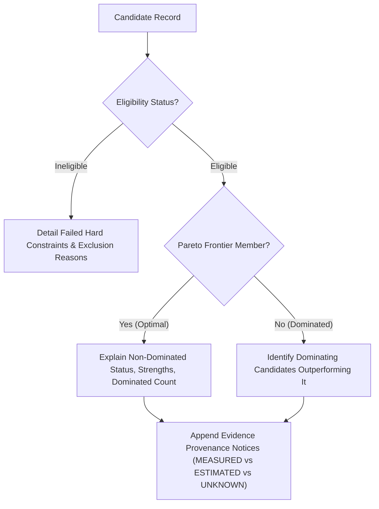

# Milestone 9: Pareto Analysis, Dominance Relationships & Explainability Architecture

**Document Version:** 1.0.0  
**Status:** IMPLEMENTED & LOCALLY VERIFIED  
**Date:** 2026-11-09  

---

## 1. Mathematical Definition of Pareto Dominance

Let $C$ denote the set of eligible candidate configurations evaluated on $k$ normalized objective dimensions:
$$\mathbf{v}(A) = \left(v_1(A), v_2(A), \dots, v_k(A)\right), \quad v_i \in [0.0, 1.0]$$
where all objectives have been normalized such that higher values represent superior outcomes.

### 1.1 Strict Dominance Condition
Candidate $A$ **strictly dominates** candidate $B$ (denoted $A \succ B$) if and only if:
1. $A$ is at least as good as $B$ on every comparable objective:
   $$\forall i \in \{1, \dots, k\}, \quad v_i(A) \ge v_i(B) - \varepsilon$$
2. $A$ is strictly better than $B$ on at least one objective:
   $$\exists j \in \{1, \dots, k\}, \quad v_j(A) > v_j(B) + \varepsilon$$
3. Both candidates possess complete, valid numerical data for all evaluated objectives:
   $$\forall i \in \{1, \dots, k\}, \quad v_i(A) \neq \text{None} \land v_i(B) \neq \text{None}$$
   where $\varepsilon = 10^{-6}$ is the floating-point tolerance parameter.

### 1.2 Strict Missing-Data Invariant
If candidate $A$ or candidate $B$ lacks data for any active objective ($v_i = \text{None}$), dominance **cannot be declared** between $A$ and $B$. Missing values are never assumed to be optimal or worst-case. The pair $(A, B)$ is marked as incomparable across that objective set.

### 1.3 Pareto Frontier Definition
The **Pareto Frontier** $\mathcal{F} \subseteq C$ is the set of all eligible candidates that are not dominated by any other eligible candidate:
$$\mathcal{F} = \{A \in C \mid \nexists B \in C \text{ such that } B \succ A\}$$
Candidates in $\mathcal{F}$ represent mathematically non-dominated architectural trade-offs: no candidate in $\mathcal{F}$ can improve in any dimension without degrading in another.

---

## 2. Ineligible Candidates and Dominance

Candidates that fail hard constraints (e.g., minimum quality, tail latency cap, memory limits, Gate 1 approval) are classified as `INELIGIBLE` or `INSUFFICIENT_EVIDENCE`.

**Invariance Rule:**
- Ineligible candidates **cannot** participate in the Pareto frontier.
- Ineligible candidates **cannot** dominate eligible candidates.
- Ineligible candidates are preserved in the run snapshot with full diagnostic traces detailing which constraints failed.

---

## 3. Deterministic Natural Language Explanation Engine

Mizan generates natural language explanations deterministically using rule-based templates driven by empirical metrics and dominance relations. **No third-party LLM is invoked for recommendation scoring or explanation generation.**

The `ExplanationEngine` synthesizes four structural components for each candidate:

### 3.1 Frontier Member Template Example
> *"Candidate 'Experiment RAG Alpha - Trial #1 (Q4_K_M)' is a non-dominated Pareto frontier member under the evaluated objectives. Observed profile: Aggregate Quality: 92.5 pts, P95 Latency: 1250.0 ms, Estimated RAM: 4200 MB, Estimated Cost: $0.00. It strictly dominates 1 other candidate(s). Evidence notice: required_ram_mb (ESTIMATED)."*

### 3.2 Dominated Candidate Template Example
> *"Candidate 'Experiment RAG Alpha - Trial #3 (FP16 Slow)' is not on the Pareto frontier because it is strictly dominated by other eligible configuration(s). Strictly outperformed across comparable objectives by: 'Experiment RAG Alpha - Trial #1 (Q4_K_M)'. Evidence notice: required_ram_mb (ESTIMATED)."*

### 3.3 Ineligible Candidate Template Example
> *"Candidate 'Experiment Cloud GPU Trial #4' is classified as INELIGIBLE. Hard constraint failure reasons: Cloud or GPU compute is blocked by global Free-Only Infrastructure Policy ($0.00 spend cap)."*

---

## 4. Auditable Human Review & Decision Capture

A recommendation engine must empower human decisions, not replace human agency. M9 incorporates a formal decision capture model (`RecommendationDecision`):

- **Decision Types:**
  - `ACCEPTED_FOR_FURTHER_REVIEW`: Configuration qualifies for downstream design review (does not trigger build or release).
  - `REJECTED`: Fails business criteria or operational trade-offs.
  - `DEFERRED`: Decision postponed pending roadmap alignment.
  - `NEEDS_MORE_EVIDENCE`: Requires higher sample sizes or hardware verification.
- **Mandatory Audit Rationale:** Every decision must record a textual justification and the actor's user ID.
- **Separation of Concerns:** Recording acceptance does **not** launch Milestone 10 model builds, trigger billable execution, or bypass Gate 2 / Gate 3 controls.
