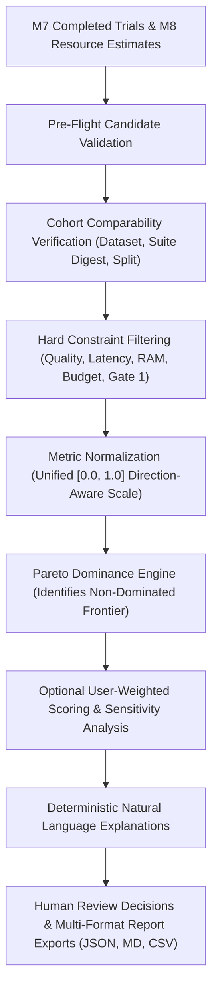

# Milestone 9: Recommendation Engine & Explainable Optimization Architecture

**Document Version:** 1.0.0  
**Status:** IMPLEMENTED & LOCALLY VERIFIED  
**Date:** 2026-11-09  

---

## 1. Architectural Mission & Boundary Enforcements

The **Mizan Milestone 9 Recommendation Engine** transforms empirical evaluation data from Milestone 6 (frozen suite verification, rubric scoring), Milestone 7 (experiment trial execution, canonical configuration digests), and Milestone 8 (hardware knowledge base, resource and memory estimation, Gate 2 cost tracking) into mathematically defensible, explainable architectural configuration recommendations.

M9 operates under strict architectural boundaries:
1. **Decision Support, Not Build or Deployment:** M9 produces immutable recommendation runs, Pareto frontiers, and decision audit logs. It does **not** perform model building, fine-tuning, or quantization (strictly owned by Milestone 10: Model Building & Colab Lab), nor artifact registry publication (owned by Milestone 11: Artifact Registry & Gate 3).
2. **Mandatory Free-Only Policy ($0.00 Spend Cap):** All multi-objective calculations, normalizations, and Pareto dominance analyses execute deterministically on local CPU. No paid optimization APIs, cloud GPUs, or third-party LLM judges are used.
3. **Traceable Scientific Provenance:** Every candidate configuration is mapped to its exact M7 experiment ID, trial ID, canonical configuration digest (RFC 8785 SHA-256), M6 evaluation run ID, Gate 1 approval attestation, and dataset/suite versions. Unmeasured, simulated, or missing attributes are explicitly flagged and never converted to synthetic zero values.

---

## 2. High-Level Recommendation Lifecycle

The deterministic recommendation pipeline follows an eight-stage lifecycle:

---

## 3. Database Schema & Data Models

M9 introduces six dedicated SQLAlchemy models registered in Alembic migration `20261109_0010_recommendations.py`:

| Model Table | Description | Key Attributes / Relationships |
| :--- | :--- | :--- |
| `recommendation_runs` | Primary container for recommendation requests. | `id`, `organization_id`, `workspace_id`, `name`, `status`, `algorithm_version`, `input_digest`, `result_digest`, `input_snapshot_json`, `normalization_snapshot_json`, `total_candidates`, `eligible_candidates`, `frontier_candidates`. |
| `recommendation_candidates` | Evaluated candidate trial configurations. | `id`, `recommendation_run_id`, `experiment_id`, `experiment_trial_id`, `configuration_digest`, `provenance_status`, `eligibility_status`, `objective_values_json`, `normalized_objective_values_json`, `constraint_results_json`, `pareto_frontier_member`, `dominated_by_json`, `dominates_json`, `weighted_score`, `explanation_text`. |
| `optimization_profiles` | User-configured preference and constraint presets. | `id`, `workspace_id`, `name`, `objectives_json`, `weights_json`, `constraints_json`, `preferred_hardware_profile`, `budget_currency`, `version`. |
| `recommendation_scenarios` | Alternative weighted scoring and sensitivity perturbation snapshots. | `id`, `recommendation_run_id`, `scenario_name`, `weight_snapshot_json`, `ranking_snapshot_json`, `explanation`. |
| `recommendation_decisions` | Auditable human review decisions recorded on candidates or runs. | `id`, `recommendation_run_id`, `selected_candidate_id`, `decision` (`ACCEPTED_FOR_FURTHER_REVIEW`, `REJECTED`, `DEFERRED`, `NEEDS_MORE_EVIDENCE`), `decision_reason`, `actor_id`. |
| `recommendation_events` | Immutable audit log of lifecycle events. | `id`, `recommendation_run_id`, `actor_id`, `event_type`, `metadata_json`, `created_at`. |

---

## 4. Multi-Tenant Isolation & Role-Based Access Control (RBAC)

All endpoints, services, and queries enforce Mizan's established multi-tenancy and anti-enumeration security:
- **Anti-Enumeration 404 Response:** Attempting to access recommendation runs, candidates, or profiles across workspace boundaries returns HTTP `404 Not Found` rather than `403 Forbidden`, preventing resource existence probing.
- **Granular RBAC Permissions:**
  - `WorkspacePermission.RECOMMENDATIONS_READ`: View runs, candidate matrices, objectives, presets, and profiles (Viewer, Member, Admin, Owner).
  - `WorkspacePermission.RECOMMENDATIONS_CREATE`: Create recommendation drafts (Member, Admin, Owner).
  - `WorkspacePermission.RECOMMENDATIONS_PROFILES_MANAGE`: Create, update, delete preference profiles (Member, Admin, Owner).
  - `WorkspacePermission.RECOMMENDATIONS_EXECUTE`: Execute multi-objective optimization calculations (Member, Admin, Owner).
  - `WorkspacePermission.RECOMMENDATIONS_DECIDE`: Record formal human review decisions (Member, Admin, Owner).
  - `WorkspacePermission.RECOMMENDATIONS_EXPORT`: Download JSON, Markdown, and CSV reports (Viewer, Member, Admin, Owner).
  - `WorkspacePermission.RECOMMENDATIONS_ARCHIVE`: Soft-archive completed recommendation runs (Admin, Owner).

---

## 5. API Endpoints

The Recommendation Engine REST API is mounted under `/api/v1/workspaces/{workspace_id}/recommendations`:

- `GET /objectives`: Lists supported optimization objectives, directions, and units from the central registry.
- `GET /presets`: Returns transparent preference weight presets (`QUALITY_FIRST`, `LATENCY_SENSITIVE`, `RESOURCE_CONSTRAINED`, `BALANCED`).
- `POST /validate-candidates`: Pre-flight candidate trial validation (verifies `COMPLETED` trial status, linked M6 eval run, Gate 1 approval).
- `POST /runs`: Executes a multi-objective recommendation run and persists immutable snapshots.
- `GET /runs`: Lists recommendation runs in the workspace with pagination and KPI summaries.
- `GET /runs/{run_id}`: Retrieves full run details including candidate matrix, Pareto dominance, weighted scenarios, and decisions.
- `POST /runs/{run_id}/archive`: Soft-archives a recommendation run.
- `POST /runs/{run_id}/decide`: Records a human review decision with mandatory rationale.
- `GET /runs/{run_id}/export`: Streams structured reports in `json`, `markdown`, or `csv` format.
- `GET /profiles`, `POST /profiles`, `GET /profiles/{id}`, `PUT /profiles/{id}`, `DELETE /profiles/{id}`: Full CRUD lifecycle for workspace preference profiles.
