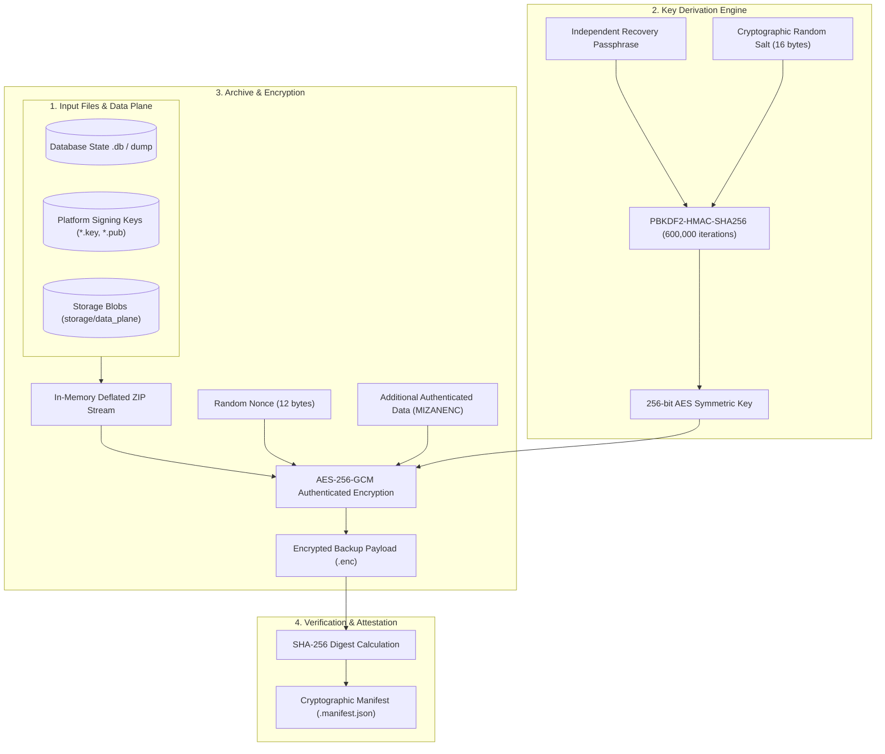

# M15 Post-Audit: Backup & Cryptographic Key Recovery Verification

## 1. Executive Summary

This report documents the architectural inspection, code hardening, and empirical verification of the **Mizan Backup and Cryptographic Key Recovery Subsystem**. 

Following Milestone 15 post-audit requirements, the backup subsystem was upgraded from unencrypted archive creation to **authenticated symmetric encryption (AES-256-GCM)** backed by **PBKDF2-HMAC-SHA256** key derivation, strictly guaranteeing that private signing keys (`.key`, `.pem`) and database state are never exposed in plaintext backup archives.

---

## 2. Technical Architecture & Cryptographic Parameters

### Cryptographic Configuration Parameters:
- **Cipher Algorithm:** AES-256-GCM (Galois/Counter Mode with 128-bit authentication tag).
- **Key Derivation Function:** PBKDF2-HMAC-SHA256 with 600,000 iterations.
- **Salt Length:** 16 bytes cryptographically secure random (`os.urandom(16)`).
- **Initialization Vector (Nonce):** 12 bytes cryptographically secure random (`os.urandom(12)`).
- **Magic Header:** 8 bytes ASCII (`MIZANENC`).
- **Secret Independence:** The backup passphrase (`BACKUP_PASSPHRASE`) is an operational secret completely decoupled from the application `SECRET_KEY` and the asymmetric Ed25519 signing keys.

---

## 3. Security Verification Checklist

| Security Control | Implementation Mechanism | Test Verification Reference |
| :--- | :--- | :--- |
| **No Plaintext Key Exposure** | Private keys are encrypted inside the AES-GCM ciphertext stream before writing to disk. | `test_backup_encryption.py::test_backup_encryption_and_restoration_cycle` |
| **Tamper-Evident Rejection** | Modifying any byte of ciphertext or authentication tag triggers `InvalidTag` from `cryptography.hazmat`, raising `BackupDecryptionError`. | `test_backup_encryption.py::test_backup_tampered_ciphertext_rejected` |
| **Independent Passphrase** | Incorrect passphrase fails decryption immediately with authentication error. | `test_backup_encryption.py::test_backup_invalid_passphrase_rejected` |
| **Zip Slip / Path Traversal Defense** | Every archive member path is resolved and validated with `is_relative_to(target_dir)`. Attempting `../../` raises `BackupSecurityError`. | `test_backup_encryption.py::test_backup_path_traversal_zip_slip_rejected` |
| **Restricted Key Permissions** | Restored `.key` and `.pem` files are written with POSIX `0o600` permissions (`chmod 600`) and default Windows restricted ACLs. | `app/core/backup_manager.py` line 209 |
| **Manifest Checksum Validation** | SHA-256 digest of the encrypted payload is cross-referenced with `.manifest.json`. | `scripts/synthetic_key_backup_rehearsal.py` Step 6 |

---

## 4. Empirical Rehearsal Results

### 4.1 Synthetic Key Backup & Recovery Demonstration
Executed via `scripts/synthetic_key_backup_rehearsal.py`:
- **Generated Key ID:** `test-only-synthetic-key-01` (119 bytes PEM).
- **Signed Manifest:** Synthetic Gate 3 release manifest signed with Ed25519.
- **Encrypted Payload Size:** 926 bytes (`key_backup.enc`).
- **Restoration Duration:** 0.288 seconds (3 files restored).
- **Signature Re-Verification:** Successfully verified synthetic manifest signature using the restored public key.
- **Tampering Test:** Flipping bit 10 in the authentication tag caused immediate decryption abort.
- **Invalid Secret Test:** Submitting wrong passphrase caused immediate authentication abort.
- **Log Exposure Audit:** Confirmed zero private key bytes or PEM headers appeared in output logs.

### 4.2 Disaster Recovery Rehearsal
Executed via `scripts/disaster_recovery_rehearsal.py`:
- **Tested Dataset:** Synthetic SQLite database with tenant/workspace tables (51,139 bytes), storage blob, and Ed25519 platform key.
- **Backup Duration:** 0.332 seconds.
- **Restore Duration:** 0.324 seconds.
- **Post-Restore Health Check:** FastAPI `/api/v1/health` returned `200 OK`.
- **Note on Scalability:** These rehearsal timings reflect a synthetic ~51 KB test database. They confirm algorithmic correctness and tamper-rejection, but **must not** be extrapolated as guaranteed production RTO for multi-gigabyte production enterprise databases.

---

## 5. Key Rotation & Revocation Implications

1. **Restoration of Rotated Keys:** Restoring an older backup restores the cryptographic key files that were active at that timestamp.
2. **Database Authority:** The platform database remains the single source of truth for key lifecycle status. If key `mizan-platform-dev-01` was revoked in the database before the disaster, restoring its private key file does not reactivate it, as `verify_gate3_attestation` queries `ModelVersionStatus` in the database.
3. **Emergency Key Revocation:** In the event of a suspected backup passphrase compromise, the platform security officer must immediately generate a new Ed25519 keypair and mark the prior key ID as `REVOKED` in the database audit log.
