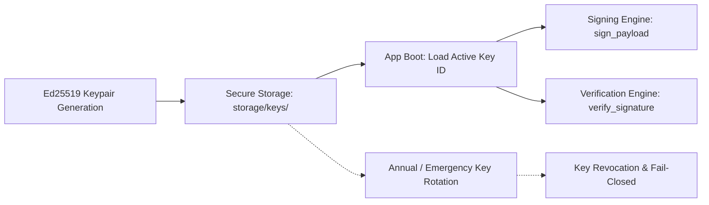

# M15 Cryptographic Trust & Key Management Architecture

## 1. Cryptographic Primitives

Mizan standardizes on high-performance, post-quantum-aware or industry-standard asymmetric and symmetric cryptography:

| Purpose | Algorithm / Primitive | Library / Specification |
| :--- | :--- | :--- |
| **Password Storage** | Argon2id (`time_cost=3`, `memory_cost=65536` [64 MB], `parallelism=4`) | `argon2-cffi` (RFC 9106) |
| **Digital Signatures** | Ed25519 (PureEdDSA over Curve25519) | `cryptography.hazmat.primitives.asymmetric.ed25519` |
| **Content Digests** | SHA-256 (Secure Hash Algorithm 256-bit) | `hashlib.sha256` |
| **Session & Token Entropy** | Cryptographically Secure Pseudorandom (32 bytes) | Python `secrets.token_urlsafe(32)` |

---

## 2. Cryptographic Domain Separation (`SignaturePurpose`)

To prevent cross-protocol and cross-gate substitution attacks, every signed payload MUST include a canonical `signature_purpose` field verified upon attestation:

```python
class SignaturePurpose(str, Enum):
    GATE1_DATA_PROTECTION = "GATE1_DATA_PROTECTION"
    GATE2_PROPOSAL = "GATE2_PROPOSAL"
    GATE3_APPROVAL = "GATE3_APPROVAL"
    SITE_COMMAND = "SITE_COMMAND"
    RUNTIME_ATTESTATION = "RUNTIME_ATTESTATION"
```

### Purpose Verification Rule
If an attestation payload contains a signature issued under `GATE1_DATA_PROTECTION` but is presented for verification to Gate 3, `verify_gate3_attestation` rejects the request immediately with `SignaturePurposeMismatchError`.

- **Evidence:** `backend/tests/security/test_security_core.py::test_sec_015_signature_purpose_substitution_rejected`.

---

## 3. Key Management & Lifecycle



### Key Storage & Permissions
1. **Private Keys:** Stored in PEM format in `storage/keys/{key_id}.pem`. File system permissions must be restricted to the application user (`chmod 600` on Linux/POSIX, restricted ACL on Windows).
2. **Key Identifiers:** Every signature embeds `key_id` in its attestation header.
3. **Fail-Closed Verification:** If `verify_signature` encounters an unknown, expired, or corrupted `key_id`, verification fails closed and raises `SignatureVerificationError`.
   - **Evidence:** `backend/tests/security/test_security_advanced.py::test_sec_040_invalid_signing_key_fails_closed`.

---

## 4. Separation of Duties Enforcement

In Gate 3 release governance:
- **Rule:** The user who authored, trained, or registered a `ModelVersion` cannot act as the reviewer to approve that model for production release.
- **Enforcement:** `submit_gate3_decision` compares `model_version.created_by` against `reviewer_user.id`. If identical and `enforce_separation_of_duties` is active, it raises `SeparationOfDutiesViolationError`.
- **Evidence:** `backend/tests/security/test_security_core.py::test_sec_016_separation_of_duties_enforced`.
