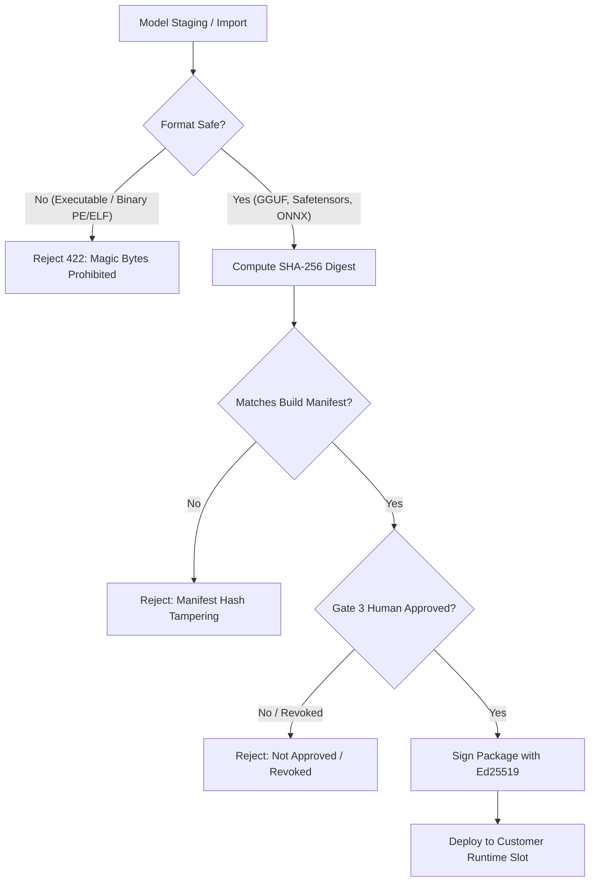

# M15 Model Supply Chain & Artifact Security

## 1. Supply Chain Attack Surface

AI and machine learning model distribution introduces distinct software supply chain risks:
- Malicious deserialization attacks (e.g. Python `pickle` code execution).
- Trojaned weights or backdoored tensors.
- Tampered release packages and substituted manifests.
- Deployment of revoked or vulnerable models.

---

## 2. Multi-Layer Supply Chain Controls

### 2.1 File Format & Magic Byte Validation
- Model files are inspected for dangerous binary headers before storage.
- If a file contains Windows PE (`MZ\x90`), Linux ELF (`\x7fELF`), Mach-O (`\xfe\xed\xfa\xce`), or shell scripts disguised as models, `validate_file_upload` rejects the file with `FileFormatUnsupportedError`.
- **Evidence:** `backend/tests/security/test_security_core.py::test_sec_018_unsafe_model_artifact_magic_bytes_rejected`.

### 2.2 SHA-256 Cryptographic Digest Verification
- Every staged artifact record stores an exact SHA-256 checksum.
- When generating or validating release packages, the digest of every contained file is cross-referenced against the signed release manifest. Any discrepancy aborts package installation.
- **Evidence:** `backend/tests/security/test_security_core.py::test_sec_014_gate3_manifest_tampering_detected`.

### 2.3 Decompression Bomb & Zip Slip Defense
- Archive uploads are screened for Zip Slip path traversal (`../`) and decompression bomb characteristics (maximum ratio 100:1, maximum decompressed size 250 MB).
- **Evidence:** `backend/tests/security/test_security_core.py::test_sec_010_decompression_bomb_rejected`.

### 2.4 Revoked Release Isolation
- A model version with status `REVOKED` cannot be downloaded, installed into a Customer Runtime slot, or selected as an automated rollback target.
- Rollback attempts targeting revoked releases abort immediately with status `ABORTED_UNSAFE_TARGET`.
- **Evidence:** `backend/tests/security/test_security_core.py::test_sec_017` and `backend/tests/security/test_security_advanced.py::test_sec_029`.
