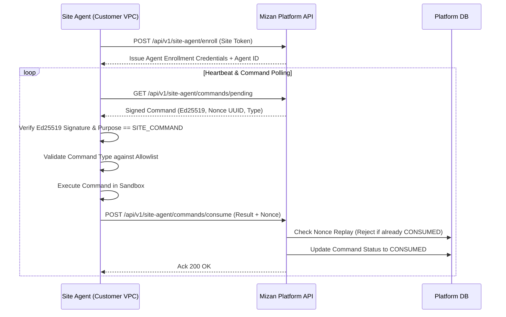

# M15 Customer Runtime & Site Agent Security

## 1. Trust Architecture & Communication Model

The **Customer Runtime** and **Site Agent** operate inside customer premises, edge appliances, or private cloud VPCs, communicating outbound to the Mizan platform API:

---

## 2. Threat Mitigations & Verification

### 2.1 Mutual Authentication & Enrollment
- Sites enroll using single-use or pre-shared high-entropy site enrollment keys.
- Enrolled agents receive distinct agent UUIDs and authorization credentials.
- **Evidence:** `test_runtime_and_site_agent_api.py`.

### 2.2 Command Type Allowlist (No Arbitrary Shell Execution)
- Attackers attempting to issue arbitrary shell commands (e.g. `rm -rf /` or `bash -c ...`) are rejected at the Pydantic schema boundary before serialization.
- Only predefined `AgentCommandType` enums (`INSTALL_PACKAGE`, `REPORT_RUNTIME_STATUS`, `EXECUTE_GOLDEN_TESTS`, `SWITCH_SLOT`) are permitted.
- **Evidence:** `backend/tests/security/test_security_advanced.py::test_sec_022_unauthorized_command_type_rejected`.

### 2.3 Nonce Replay Prevention
- Every platform command includes a unique UUIDv4 nonce.
- Once a command is consumed, attempting to replay the same command payload or nonce raises `ReplayedNonceError`.
- **Evidence:** `backend/tests/security/test_security_advanced.py::test_sec_021_site_agent_command_replay_rejected`.

### 2.4 Golden Test Sandbox & Blue/Green Slot Transitions
- Runtime applications run in dual slots (`SLOT_A`, `SLOT_B`).
- New packages are installed into the staged slot and evaluated with automated Golden Tests before routing traffic.
- If golden tests fail, traffic remains on the active slot with zero customer downtime.
- **Evidence:** `test_sec_028_invalid_rollback_target_slot`.
