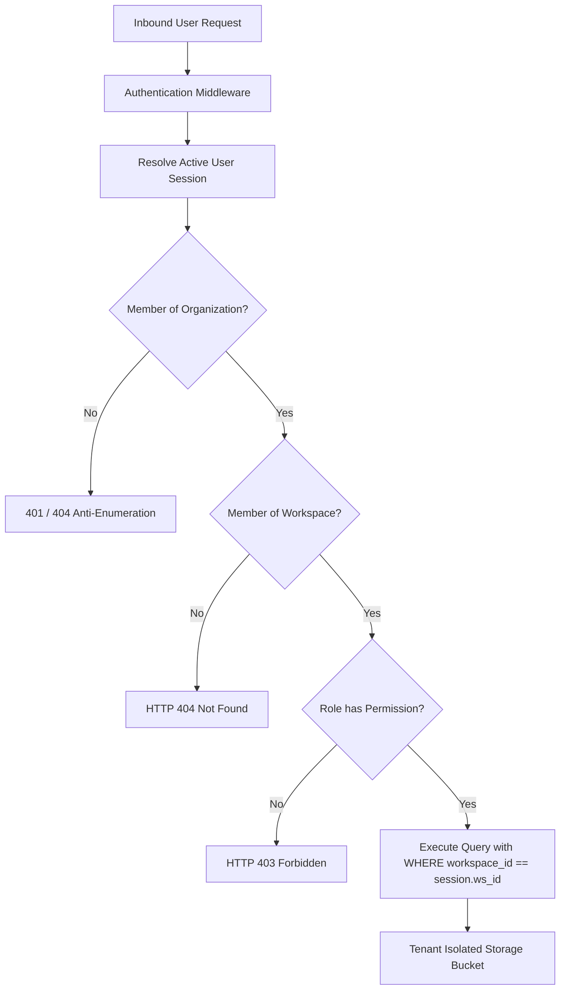

# M15 Multi-Tenant Isolation Audit

## 1. Architectural Model & Scope

Mizan implements a **Logical Multi-Tenancy Architecture** with dual-level organizational hierarchy:
1. **Organization (`Organization`):** Top-level billing, identity, and governance boundary.
2. **Workspace (`Workspace`):** Operational sandbox for datasets, experiments, models, runtime sites, and incidents.

All shared database tables and storage directories are logically segmented using dual-foreign-key constraints (`organization_id`, `workspace_id`).

---

## 2. Tenant Isolation Enforcement Layers

---

## 3. Audited Resource Dimensions

### 3.1 Workspaces & Membership
- **Mechanism:** Workspaces belong to exactly one Organization. Membership is strictly validated in `app/modules/workspaces/`.
- **Anti-Enumeration:** Requesting `/api/v1/workspaces/{foreign_ws_id}` returns HTTP 404 instead of 403, preventing attackers from confirming the existence of competitor workspaces.
- **Evidence:** `test_sec_002` and Penetration Test `IDOR-01`.

### 3.2 Datasets & Documents
- **Mechanism:** Files are saved under `storage/data_plane/{workspace_id}/{dataset_id}/`. File paths are normalized and verified to reside inside the workspace sandbox root.
- **Path Traversal Defense:** Filenames containing `../` or `..\\` are stripped or rejected.
- **Evidence:** `test_sec_009_storage_path_traversal_rejected`.

### 3.3 Retrieval-Augmented Generation (RAG) & Vector Storage
- **Mechanism:** RAG chunk retrieval queries explicitly include `workspace_id == caller_workspace_id`.
- **Verification:** An attacker querying the RAG pipeline in Workspace B cannot retrieve embeddings or documents uploaded in Workspace A.
- **Evidence:** `test_sec_019_cross_tenant_rag_retrieval_isolated`.

### 3.4 Artifact Registry & Releases
- **Mechanism:** Model families and versions are uniquely bound to `workspace_id`. Gate 3 approvals must be performed by authorized workspace reviewers.
- **Evidence:** `test_sec_014` and `test_sec_016`.

### 3.5 Operations, Monitoring & Incidents
- **Mechanism:** Incident tracking, alert rules, rollback policies, and notification channels are guarded by `_verify_workspace_ops_access`.
- **Anti-Enumeration:** Attempting to view or modify an incident in another tenant's workspace returns 404.
- **Evidence:** `test_sec_037_cross_tenant_incident_access_anti_enumeration` and `test_sec_038_unauthorized_rollback_policy_modification`.

---

## 4. Preserved Audit Note on Database Engine

- **SQLite Verification:** Fully verified and regression tested (271 tests passing).
- **Remote MySQL Concurrency Blocker:** Preserved as `M2.B1 Step 3 — Remote MySQL Concurrency Verification: BLOCKED` until live multi-client testing against a remote MySQL server is conducted.
